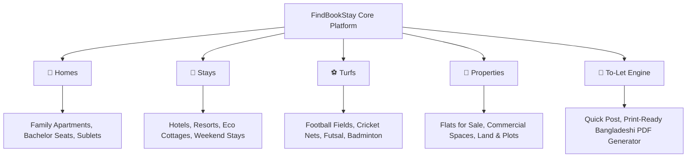

<div align="center">

# 🏡 FindBookStay — Backend Engine API

### *High-Performance Multi-Vertical Real Estate, Hospitality & Sports Turf Platform*

[](https://nodejs.org/)
[](https://www.typescriptlang.org/)
[](https://expressjs.com/)
[](https://www.mongodb.com/)
[](https://redis.io/)
[](https://socket.io/)
[](#-interactive-api-documentation)
[](LICENSE.md)

<p align="center">
  <b>FindBookStay</b> powers a modern verified marketplace connecting renters, travelers, athletes, and property buyers directly with verified owners, hosts, and turf managers across Bangladesh — with 0% broker fees.
</p>

[Explore Documentation](#-api-routes-overview) • [Installation](#-getting-started) • [Environment Setup](#-environment-variables) • [Architecture](#-system-architecture)

</div>

---

## 🚀 Key Highlights & Capabilities

* 🏘️ **Dedicated Multi-Vertical Engine**:
  * Four independent collections and optimized schema pipelines for **Homes**, **Stays**, **Turfs**, and **Properties** — replacing fragile monolithic designs with purpose-built data models.
* ⚡ **Blazing-Fast Cache Layer (Redis)**:
  * Powered by `ioredis` with smart cache-aside patterns, query fingerprinting, and automated real-time cache invalidation on mutations (inserts, updates, reviews, deletes).
* 📄 **Bangladeshi To-Let & Printable PDF Engine**:
  * High-speed creation of traditional Bangladeshi-format To-Let advertisements with dynamic high-resolution printable PDF exports generated on the fly via `PDFKit`.
* 💬 **Real-Time Messaging with WebSockets**:
  * Persistent bidirectional chat built with `Socket.io`, typing indicators, message read receipts, and binary attachments.
* 🖼️ **High-Performance Image Processing Pipeline**:
  * Integrated `Sharp` image pipeline providing automatic WebP conversion, EXIF auto-rotation, multi-resolution resizing, and up to 80% compression reduction for all uploads.
* 📍 **Geospatial Proximity Queries**:
  * Native MongoDB `2dsphere` spatial indexing on GeoJSON Point coordinates `[longitude, latitude]` for radius-based near-me searches.
* 🛡️ **Enterprise Security & Role-Based Access (RBAC)**:
  * Strict access control guards supporting `SUPER_ADMIN`, `ADMIN`, `MODERATOR`, `HOST`, and `USER` roles, bcrypt password hashing, and signed HTTP-only JWTs.
* 📑 **Interactive Swagger / OpenAPI Documentation**:
  * Fully documented interactive API explorer served live at `/api/v1/docs`.

---

## 🎯 The 4 Core Verticals



| Vertical | Path | Primary Use Case | Key Features |
| :--- | :--- | :--- | :--- |
| **Homes** | `/api/v1/homes` | Long-term residential rent | Bachelor seats, flats, sublets, bills included, floor/lift info |
| **Stays** | `/api/v1/stays` | Short-term & vacation booking | Check-in/out policies, room types, guest limits, resort amenities |
| **Turfs** | `/api/v1/turfs` | Hourly sports ground booking | Slot duration, pitch surface, floodlights, spectator capacity |
| **Properties** | `/api/v1/properties` | Real estate sales & investment | Commercial & residential sales, land area, ownership verification |
| **To-Lets** | `/api/v1/tolets` | Rapid Bangladesh rental ads | Auto-generated printable PDF flyers for offline house notices |

---

## 🛠️ Technology Stack

| Layer | Technologies |
| :--- | :--- |
| **Runtime & Language** | [Node.js (>=18.x)](https://nodejs.org/) &bull; [TypeScript 5.x](https://www.typescriptlang.org/) |
| **Web Framework** | [Express 5.x](https://expressjs.com/) (Async routing & performance enhancements) |
| **Primary Database** | [MongoDB](https://www.mongodb.com/) via [Mongoose 9.x](https://mongoosejs.com/) (`2dsphere` geospatial indexing) |
| **Cache & In-Memory Store** | [Redis](https://redis.io/) via [ioredis](https://github.com/redis/ioredis) (Query fingerprint caching & cache-aside invalidation) |
| **Realtime Engine** | [Socket.io 4.x](https://socket.io/) (Rooms, message dispatch, live online status) |
| **Image Optimization** | [Sharp](https://sharp.pixelplumbing.com/) (WebP conversion, auto-rotation, lossless compression) |
| **PDF Generation** | [PDFKit](https://pdfkit.org/) (Bangladeshi To-Let high-res vector printable documents) |
| **API Documentation** | [Swagger UI](https://swagger.io/) & [OpenAPI 3.0](https://swagger.io/specification/) |
| **Validation & Safety** | [Zod 4.x](https://zod.dev/) (Strict request schema enforcement & type inference) |
| **Email Services** | [Nodemailer](https://nodemailer.com/) &bull; [Resend](https://resend.com/) (Transactional emails & OTPs) |
| **Security** | JWT (JSON Web Tokens), Bcrypt, Cookie-Parser, CORS, Helmet policies |

---

## 📂 Project Structure

```text
FindBookStay-Backend/
├── public/                 # Static landing page, status indicator, assets
├── src/
│   ├── app/
│   │   ├── config/         # Environment variables & runtime configurations
│   │   ├── docs/           # Swagger specification & OpenAPI routes
│   │   ├── enums/          # Shared platform enums (ListingCategory, Roles, etc.)
│   │   ├── errors/         # Global ApiError classes & centralized handler
│   │   ├── middlewares/    # Auth guards, role authorization, Multer file upload
│   │   ├── modules/        # Domain-driven modular architecture:
│   │   │   ├── activityLog/    # System audit logs & admin action history
│   │   │   ├── address/        # Bangladeshi administrative divisions & districts
│   │   │   ├── auth/           # Registration, login, JWT refresh, OTP recovery
│   │   │   ├── conversation/   # Chat thread tracking & room participation
│   │   │   ├── faq/            # Frequently asked questions & categories
│   │   │   ├── favorite/       # Polymorphic wishlist (Home, Stay, Turf, Property)
│   │   │   ├── home/           # Residential flats, sublets & bachelor rentals
│   │   │   ├── lastViewed/     # Dynamic browsing history tracking
│   │   │   ├── listingView/    # Analytics & unique visitor hit tracking
│   │   │   ├── message/        # Real-time WebSocket chat messages & uploads
│   │   │   ├── notification/   # In-app alerts, push notifications & unread counts
│   │   │   ├── policy/         # Terms of Service, Privacy & Cancellation policies
│   │   │   ├── property/       # Real estate property sales & commercial spaces
│   │   │   ├── report/         # Community reports & moderation system
│   │   │   ├── review/         # Dynamic multi-vertical reviews & rating aggregations
│   │   │   ├── settings/       # Per-user preferences, notifications & privacy toggles
│   │   │   ├── siteSettings/   # Global branding, business rules, feature flags (Redis cached)
│   │   │   ├── stay/           # Hotel, resort & holiday accommodation bookings
│   │   │   ├── tolet/          # Bangladeshi To-Let poster engine & PDF generator
│   │   │   ├── turf/           # Hourly sports courts, football & futsal fields
│   │   │   ├── user/           # User profiles, avatar uploads & management
│   │   │   ├── userAddress/    # Saved addresses with 2dsphere GeoJSON points
│   │   │   └── visitor/        # Daily unique visitor analytics
│   │   └── routes/         # Central routing registry
│   ├── utils/              # Redis client, catchAsync, sendResponse, emailers
│   ├── app.ts              # Express setup, middleware chains & error handlers
│   └── server.ts           # Server bootstrap, Socket.io initialization & MongoDB connection
├── uploads/                # Local optimized media directory (profiles, listings, site)
├── package.json            # Scripts and dependencies
└── tsconfig.json           # Strict TypeScript compiler options
```

---

## 🛣️ API Routes Overview

Interactive documentation is available at **`/api/v1/docs`**.

### 1. 🔐 Authentication (`/api/v1/auth`)
| Method | Endpoint | Access | Description |
| :--- | :--- | :--- | :--- |
| `POST` | `/api/v1/auth/register` | Public | Register a new user account |
| `POST` | `/api/v1/auth/login` | Public | Authenticate user & receive access/refresh tokens |
| `POST` | `/api/v1/auth/refresh-token` | Public | Exchange refresh token for new access token |
| `POST` | `/api/v1/auth/forgot-password`| Public | Send 6-digit password reset OTP email |
| `POST` | `/api/v1/auth/verify-otp` | Public | Verify OTP code |
| `POST` | `/api/v1/auth/reset-password` | Public | Set new password with verified OTP |
| `GET` | `/api/v1/auth/me` | Authenticated | Retrieve authenticated user profile |
| `PATCH`| `/api/v1/auth/update-profile` | Authenticated | Update profile details (with avatar upload) |
| `POST` | `/api/v1/auth/change-password`| Authenticated | Change account password |
| `DELETE`| `/api/v1/auth/deactivate` | Authenticated | Soft deactivate account |

### 2. 🏡 Homes / Rentals (`/api/v1/homes`)
| Method | Endpoint | Access | Description |
| :--- | :--- | :--- | :--- |
| `GET` | `/api/v1/homes` | Public | Query homes with filters (rent, beds, bachelor/family, geo) |
| `GET` | `/api/v1/homes/featured` | Public | Get featured homes (Redis cached) |
| `GET` | `/api/v1/homes/:id` | Public | Get single home by ID, slug, or propertyNumber |
| `POST` | `/api/v1/homes` | Host / Admin | Publish new home (supports multi-image upload) |
| `PATCH`| `/api/v1/homes/:id` | Owner / Admin | Update home details |
| `DELETE`| `/api/v1/homes/:id` | Owner / Admin | Soft delete home listing |

### 3. 🏨 Stays / Resorts (`/api/v1/stays`)
| Method | Endpoint | Access | Description |
| :--- | :--- | :--- | :--- |
| `GET` | `/api/v1/stays` | Public | Search stays, hotels, eco-resorts & cottages |
| `GET` | `/api/v1/stays/featured` | Public | Get featured stays (Redis cached) |
| `GET` | `/api/v1/stays/:id` | Public | Get stay details by ID, slug, or stayNumber |
| `POST` | `/api/v1/stays` | Host / Admin | Publish new stay listing |
| `PATCH`| `/api/v1/stays/:id` | Owner / Admin | Update stay listing |
| `DELETE`| `/api/v1/stays/:id` | Owner / Admin | Delete stay listing |

### 4. ⚽ Turfs / Courts (`/api/v1/turfs`)
| Method | Endpoint | Access | Description |
| :--- | :--- | :--- | :--- |
| `GET` | `/api/v1/turfs` | Public | Search sports turfs, futsal grounds & courts |
| `GET` | `/api/v1/turfs/featured` | Public | Get featured turfs (Redis cached) |
| `GET` | `/api/v1/turfs/:id` | Public | Get turf details by ID, slug, or turfNumber |
| `POST` | `/api/v1/turfs` | Host / Admin | Create a sports turf listing |
| `PATCH`| `/api/v1/turfs/:id` | Owner / Admin | Update turf details |
| `DELETE`| `/api/v1/turfs/:id` | Owner / Admin | Delete turf listing |

### 5. 🏢 Properties for Sale (`/api/v1/properties`)
| Method | Endpoint | Access | Description |
| :--- | :--- | :--- | :--- |
| `GET` | `/api/v1/properties` | Public | Search residential & commercial properties for sale |
| `GET` | `/api/v1/properties/featured`| Public | Get featured properties (Redis cached) |
| `GET` | `/api/v1/properties/:id` | Public | Get property by ID, slug, or propertyNumber |
| `POST` | `/api/v1/properties` | Owner / Admin | Create property sale listing |
| `PATCH`| `/api/v1/properties/:id` | Owner / Admin | Update property listing |
| `DELETE`| `/api/v1/properties/:id` | Owner / Admin | Delete property listing |

### 6. 📄 Bangladeshi To-Let Engine (`/api/v1/tolets`)
| Method | Endpoint | Access | Description |
| :--- | :--- | :--- | :--- |
| `POST` | `/api/v1/tolets` | Public / Auth | Submit quick To-Let notice data |
| `GET` | `/api/v1/tolets/:id` | Public | View To-Let notice details |
| `GET` | `/api/v1/tolets/:id/pdf` | Public | **Download printable high-res A4 To-Let notice PDF** |

### 7. ⭐ Reviews & Dynamic Ratings (`/api/v1/reviews`)
| Method | Endpoint | Access | Description |
| :--- | :--- | :--- | :--- |
| `POST` | `/api/v1/reviews` | Authenticated | Review a Home, Stay, Turf, or Property |
| `GET` | `/api/v1/reviews/listing/:id`| Public | Get reviews & 1–5 star breakdown for a listing |
| `PATCH`| `/api/v1/reviews/:id` | Author / Admin | Edit review |
| `POST` | `/api/v1/reviews/:id/reply` | Owner / Admin | Owner reply to review |
| `DELETE`| `/api/v1/reviews/:id` | Author / Admin | Delete review & recalculate rating average |

### 8. ❤️ Favorites & Wishlists (`/api/v1/favorites`)
| Method | Endpoint | Access | Description |
| :--- | :--- | :--- | :--- |
| `POST` | `/api/v1/favorites` | Authenticated | Toggle favorite across any vertical |
| `GET` | `/api/v1/favorites/my-favorites` | Authenticated | Get user's saved wishlist items |
| `DELETE`| `/api/v1/favorites/:listingId`| Authenticated | Remove item from favorites |

### 9. 💬 Realtime Chat & Conversations (`/api/v1/conversations`, `/api/v1/messages`)
| Method | Endpoint | Access | Description |
| :--- | :--- | :--- | :--- |
| `GET` | `/api/v1/conversations` | Authenticated | List all active conversation threads |
| `POST` | `/api/v1/conversations` | Authenticated | Start or resume chat with host/owner |
| `GET` | `/api/v1/messages/:conversationId` | Authenticated | Fetch conversation message history |
| `POST` | `/api/v1/messages` | Authenticated | Send message (with optional Sharp-optimized attachments) |

### 10. ⚙️ Platform & User Settings (`/api/v1/site-settings`, `/api/v1/settings`)
| Method | Endpoint | Access | Description |
| :--- | :--- | :--- | :--- |
| `GET` | `/api/v1/site-settings` | Public | Global site branding, SEO, maintenance, feature flags |
| `PATCH`| `/api/v1/site-settings` | Admin | Update site configuration & branding logos |
| `GET` | `/api/v1/settings` | Authenticated | Get current user's preferences & privacy settings |
| `PATCH`| `/api/v1/settings` | Authenticated | Update user's theme, notifications & language |
| `POST` | `/api/v1/settings/reset`| Authenticated | Reset user settings to defaults |

---

## ⚙️ Environment Variables

Create a `.env` file in the root directory:

```env
# Server Configuration
NODE_ENV=development
PORT=5000
SERVER_URL=http://localhost:5000
CLIENT_URL=http://localhost:3000

# Database
MONGODB_URL=mongodb://localhost:27017/findbookstay

# Redis Cache
REDIS_URL=redis://127.0.0.1:6379
REDIS_HOST=127.0.0.1
REDIS_PORT=6379
REDIS_PASSWORD=

# JWT Secrets & Expirations
JWT_ACCESS_SECRET=your_super_secret_jwt_access_key
JWT_ACCESS_EXPIRE=30d
JWT_REFRESH_SECRET=your_super_secret_jwt_refresh_key
JWT_REFRESH_EXPIRE=365d
JWT_PASSWORD_RESET_SECRET=your_password_reset_secret_key
BCRYPT_SALT_ROUNDS=12

# Mailer Configuration (NODEMAILER or RESEND)
MAIL=NODEMAILER
SMTP_HOST=smtp.mailtrap.io
SMTP_PORT=2525
SMTP_SECURE=false
SMTP_USER=your_smtp_username
SMTP_PASS=your_smtp_password
RESEND_API_KEY=re_your_resend_api_key
RESEND_FROM_EMAIL=no-reply@findbookstay.com

# Stripe Payments (Optional)
STRIPE_PUBLISHABLE_KEY=pk_test_...
STRIPE_SECRET_KEY=sk_test_...
STRIPE_WEBHOOK_SECRET=whsec_...

# Initial Super Admin Seed
INITIAL_ADMIN_NAME="Appon Islam"
INITIAL_ADMIN_EMAIL=admin@findbookstay.com
INITIAL_ADMIN_PASSWORD=adminpassword123
INITIAL_ADMIN_PHONE=+8801700000000

# External Services
MAPS_API_KEY=your_google_maps_key
TURNSTILE_SECRET_KEY=your_cloudflare_turnstile_secret
```

---

## 🚀 Getting Started

### Prerequisites
* **Node.js**: `v18.0.0` or higher
* **MongoDB**: `v6.0` or higher (running locally or MongoDB Atlas)
* **Redis**: `v6.0` or higher (running locally or cloud instance)

### 1. Clone & Install
```bash
git clone https://github.com/your-username/FindBookStay-Backend.git
cd FindBookStay-Backend
npm install
```

### 2. Run Redis & MongoDB
Ensure both MongoDB and Redis services are active:
```bash
# Redis
redis-server

# MongoDB
mongod
```

### 3. Start Development Server
```bash
npm run dev
```
The server will boot on `http://localhost:5000` with hot-reload enabled.

### 4. Interactive API Documentation
Open your browser and navigate to:
```text
http://localhost:5000/api/v1/docs
```

### 5. Build for Production
```bash
npm run build
npm start
```

---

## ⚡ Real-Time Socket.io Events

The Socket.io gateway runs on the same HTTP server port.

| Event Name | Direction | Payload | Description |
| :--- | :--- | :--- | :--- |
| `connection` | Client -> Server | Header Auth Token | Authenticates socket connection |
| `join_room` | Client -> Server | `{ conversationId: string }` | Joins a conversation room |
| `leave_room` | Client -> Server | `{ conversationId: string }` | Leaves a conversation room |
| `send_message` | Client -> Server | `{ conversationId, text, ... }` | Emits message to conversation members |
| `new_message` | Server -> Client | Message Object | Delivers new incoming message |
| `user_typing` | Bidirectional | `{ conversationId, userId }` | Broadcasts typing indicator |

---

## 🛡️ Production Best Practices & Quality Controls

* **Zero Unchecked Types**: Strictly typed interfaces and Zod request sanitization at boundary layers.
* **Non-Blocking Cache Invalidation**: Asynchronous Redis scan-and-delete operations that prevent event-loop delays.
* **Auto-Generating Slugs**: Collision-resistant alphanumeric property and stay slugs for clean SEO-friendly URLs.
* **Auto-Aggregated Ratings**: Real-time MongoDB aggregation pipeline updating listing rating averages and review counts instantaneously.
* **Polymorphic Referencing**: Robust schema decoupling via `refPath` for unified review, favorite, and tracking services across distinct verticals.

---

## 📝 License

Distributed under the **MIT License**. See [LICENSE.md](LICENSE.md) for full terms.

---

<div align="center">
  <b>Developed with ❤️ for the FindBookStay Platform</b><br />
  <sub>Empowering transparent, direct real estate, stays & turf bookings across Bangladesh.</sub>
</div>
